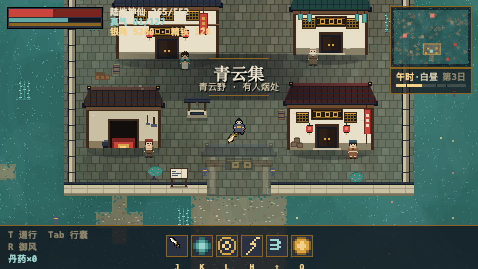
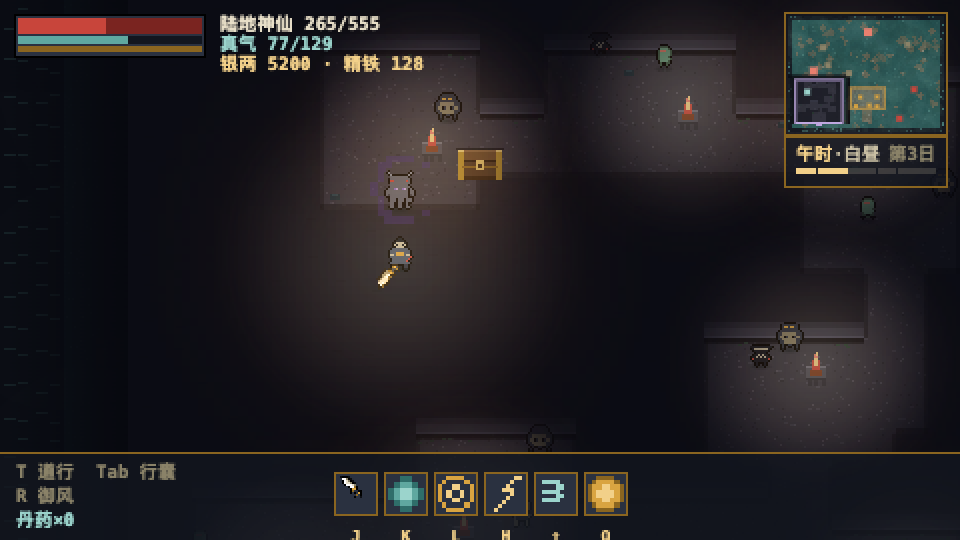
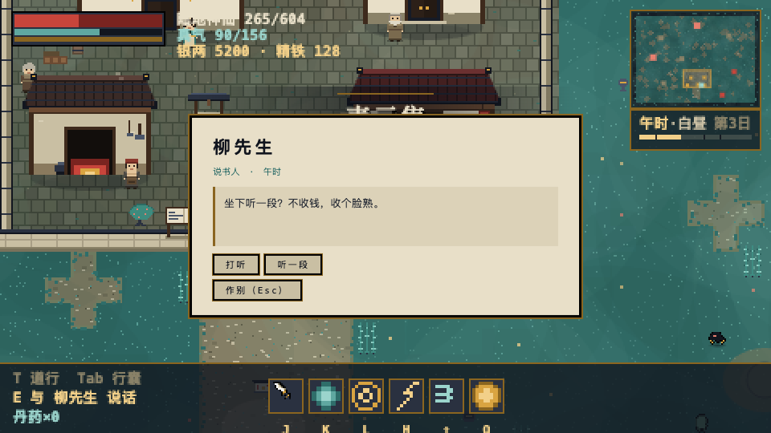
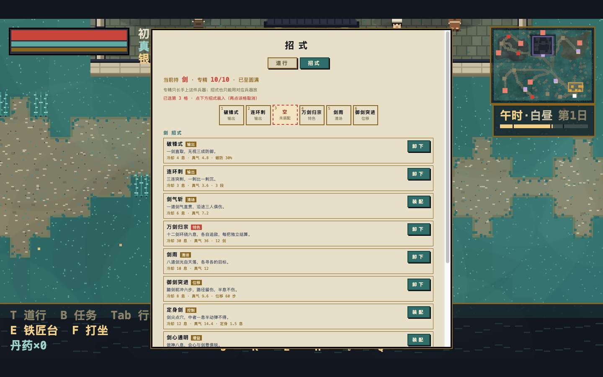
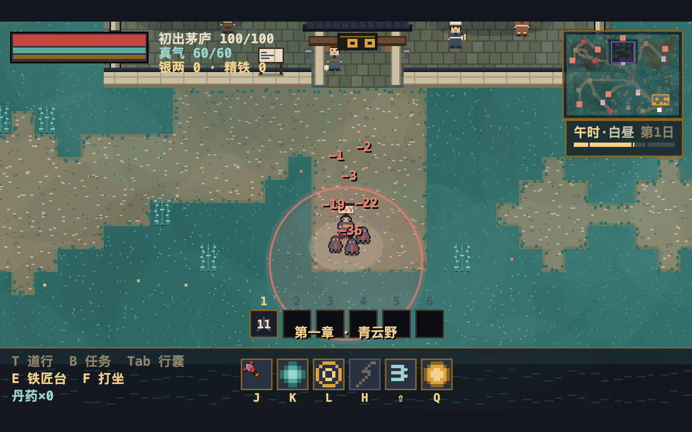
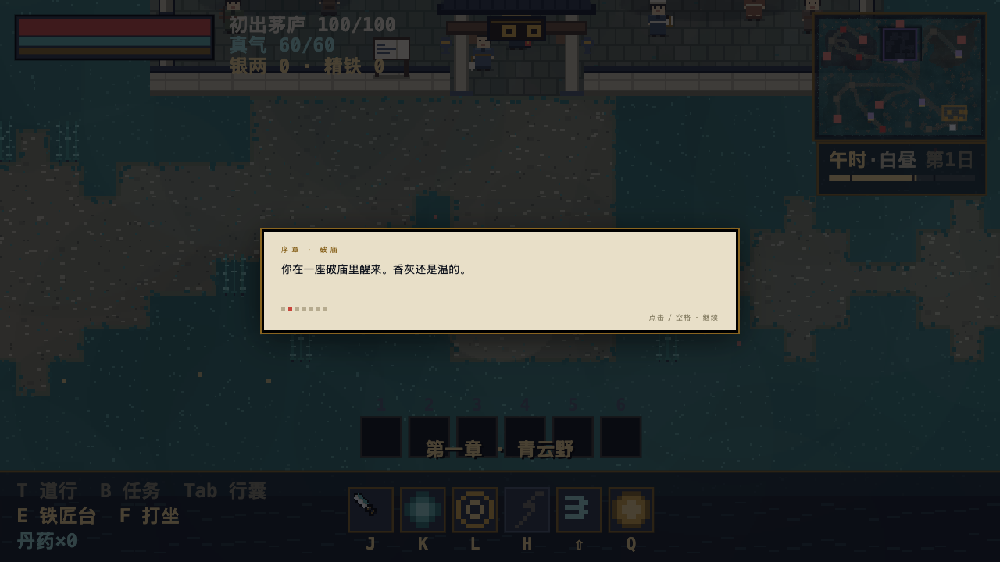
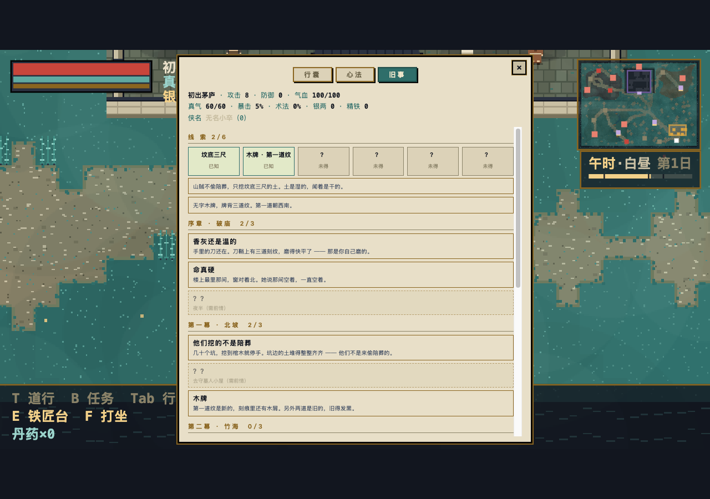

# 逍遥行

> 中国风像素 ARPG · 纯静态 · 零构建依赖 · 借鉴《第九黎明》的机制，表达全原创

一个可以直接在浏览器里跑的单机像素动作 RPG。手绘级程序化像素美术（24 色锁定板），
武侠表达（银两 / 历练 / 境界 / 侠名 / 道行），砍杀、刷宝、昼夜流转、村庄 NPC 生态与三层地宫。

**在线试玩**：https://wbapp-rr8ivulyupjzpv5mlwnkqs.apps.workbuddy.host/?sharecode=43IYY3J22B



| 青云古洞·洞主 | 村中对话 |
|---|---|
|  |  |

| 招式装配页（P6） | 火雨地面区域（P6） |
|---|---|
|  |  |

| 剧情（P7） | 旧事页（P7） |
|---|---|
|  |  |

---

## 快速开始

**方式一（推荐，开发态）**

```bash
cd dawn-s1
node server.js          # 0.0.0.0:8124
# 打开 http://127.0.0.1:8124/
```

PC 浏览器打开就是键鼠操作（`WASD` 走位、`J/K/L/H` 出招，底部技能栏带键位）；
手机 / 平板同局域网访问终端打印的局域网地址时，才**自动切换为虚拟摇杆与动作键**。
判定依据是「主输入设备是不是手指」（`pointer: coarse` / `hover: none` + 移动端 UA），
不是「设备是否支持触摸」——带触屏的 Windows 笔记本、`ontouchstart` 为真的桌面 Chrome 仍按 PC 处理。
标题页底部可手动切换（选择会记住），也支持 `?touch=1` 强制摇杆、`?touch=0` 强制键鼠、`?touch=auto` 恢复自动；
触屏本接键盘、平板插鼠标这类混合设备，会按最后一次真实输入自动切。

**方式二（零服务，双击即玩）**

先打包一次，之后直接双击 `dawn-s1/逍遥行.html` 即可（单文件，内联引擎与全部美术）：

```bash
cd dawn-s1
node build.js           # 产出 xiaoyao-bundle.js 与 逍遥行.html
```

`index.html` 会按 `location.protocol` 自动分流：`http` 走原生 ES module，`file:` 走打包版，
所以开发流程不变，同时双击也不会白屏。

## 操作

同一份页面按设备自动分流，不需要分别做移动版 / PC 版。

| 操作 | 键鼠 | 触屏 |
|---|---|---|
| 移动 | `WASD` / 方向键 | 左下虚拟摇杆（按点即圆心） |
| 斩击 | `J` / 空格 | 攻击键 |
| 剑气 | `K`（2.5s） | 技能键 |
| 剑舞 | `L`（6s，周身 AoE + 击退） | 技能键 |
| 身法 | `Shift`（0.9s，冲刺闪避帧） | 闪避键 |
| 回春丹 | `Q` | 药键 |
| 行囊 / 装备 | `Tab` / `I` | 面板按钮 |
| 交互 | `E` / 走近自动提示 | 交互键（随场景变文案） |

## 已实现

- **战斗与打击感**：扇形斩击判定、八类兵器各自招式与刀光外观（剑 / 刀 / 枪 / 棍 / 双刃 / 锤 / 法杖 / 暗器）、
  暴击/连击/命中顿帧/震屏/数字弹出；敌方投射物在墙根弹掉。
- **八类兵器，五系三段**：刀＝三式半圆弧斩；剑＝前两段向前窄挥 + 末段直刺；枪＝试探刺 → 横扫 → 贯甲刺；
  法杖＝一/二/三粒气弹；暗器＝一/三/五枚飞镖扇射。攻距与判定弧度整体收小，
  远程兵器复用同一套投射物系统（命中 / 穿怪 / 暴击），不消耗真气。
- **兵器造型与品阶**：仙品起换剪影（护手镶珠、刃侧开锋），传世加冠顶；
  同族同品阶还有 3 种宝石纹样，所以「剑」这一族能读出十几种长相。
  传世兵器手持带品阶辉光，掉在地上有加粗光柱 + 脚下光环。
- **手持手感**：兵器缩到掌中尺寸（0.56 倍）、锚点落在角色的手上而不是胸口；
  `?weapon=attack` 可切成「平时不显示兵器、只有出招时才显形」。
- **刷装备**：稀有度掉落（R0~R4）、四槽位装备栏（衣 / 武器 / 项链 / 法宝）、
  词缀与回收（`salvageValue`），兵器槽权重 40%（八类都能刷到），洞主大箱保底 R2、必出 3 件。
- **成长**：仙侠道行树、江湖称号六级、侠名五档（0/5/15/30/60，影响买卖价）。
- **招式系统**：八兵器 × 八招 = **64 个招式**（输出 / 清场 / 位移 / 控制 / 增益 / 特色六种功能位），
  兵器专精 0→10 级解锁，六个招式槽键位 `1`~`6`；十种效果原语覆盖近战 / 弹体 / 环绕 / 落雷 /
  位移 / 增益 / 地面区域 / 拉拽；装配页按功能位分组，先点格子再点招式装入。
- **心法系统**：22 条心法（一主二辅互斥，共 540 种组合），零动画纯数据构筑层。
- **剧情**：序章 + 三物线索链（木牌三道纹依次点亮，每道纹指出下一件在哪）；
  六种触发器，剧情播放时世界暂停；行囊「旧事」页可回看已读剧情、未读只显示条件；
  8 个 NPC 按侠名分「初见 / 熟识 / 深交」三层说话；6 处碑文走近按 E 读。
- **世界**：96×72 大图、14 分钟一日的昼夜四段（卯 / 午 / 酉 / 子，离屏合成，色罩比 0.4~0.7）。
- **青云集**：可进入的村庄，酒馆 / 药铺 / 铁匠铺 / 货郎四家店按 `openWhen` 开关门，
  七位村民各有时辰作息与独立对话；存档点回血。
- **青云古洞**：世界地图内嵌的三层地牢（不切场景、矩形占位重写地形），程序化生成
  6~10 间房 + L 形走廊（240 次种子压测全连通），清层才开地脉裂口，洞内恒暗靠火把照明，
  第三层洞主「岩魈」。死在洞里这一趟重排。

## 目录结构

```
xiaoyaoxing/
├── dawn-s1/                 游戏主目录
│   ├── index.html           外壳 + 双 canvas + 全部 DOM 面板 + boot 分流
│   ├── game.js              主循环 / 战斗 / 掉落 / HUD / 存档（最大的一个）
│   ├── pixel.js             24 色板 C、spriteCanvas、mirror/outlined/blit/tintHex
│   ├── art.js  monsters.js  程序化美术与敌手定义
│   ├── weapons.js items.js  兵器招式、装备与词缀
│   ├── arts.js   mantras.js  招式系统（64 招 · 十种原语）、心法系统（22 条）
│   ├── quests.js story.js   任务（10 条）、剧情（10 节点 · 线索 · 三层对话）
│   ├── skills.js time.js    道行树、昼夜时辰
│   ├── village.js           青云集：建筑、NPC、店铺、对话
│   ├── dungeon.js           青云古洞：生成器、地形绘制、宝箱火盆
│   ├── devtest.js           头less 回归测试（137 条断言）
│   ├── build.js             按依赖序打 IIFE 单文件
│   ├── tools/               shot.js（CDP 截图）/ touch.js（触屏回归）/ weapons.js（兵器专项）/
│   │                        arts.js（招式）/ mantras.js（心法）/ story.js（剧情）/ play.js
│   ├── lib/three.module.js  本地化 three.js r160（离线可玩）
│   └── CHAPTER-1.md         第一章交付文档 / ECOSYSTEM-PLAN.md 生态升级计划
├── pixel-menu/              最早的主菜单视觉原型
└── sprite_pipeline.py       外部素材 → 像素图的处理管线
```

## 构建与测试

```bash
cd dawn-s1
node build.js                     # 打包单文件（file:// 用）
# 浏览器打开 http://127.0.0.1:8124/?dev=1 —— 页面左上角输出回归结果
node tools/touch.js               # 触屏摇杆/按键回归（需先起 server）
node tools/shot.js                # CDP 截图（SHOT_W/SHOT_H/MOBILE/DPR/WAIT 可调）
```

逻辑分辨率 480×270（正交相机，世界 +Y 朝屏下），headless 下 RAF 被节流，
因此所有断言走确定性钩子 `window.__game.tick(dt)` 手动步进。

## 进度

> **换账号 / 隔一段时间回来做，先看 [`dawn-s1/HANDOFF.md`](dawn-s1/HANDOFF.md)** ——
> 现状、怎么跑、怎么验证、下一步、踩过的坑，全在里面。

- [x] 第一章 · 青云野（兵器 / 道行 / 刷宝 / 打击感）
- [x] 昼夜系统 · 青云集村庄 · NPC 生态与侠名
- [x] 青云古洞（三层地牢 + 洞主）
- [x] **第一章扩容**：地图 ×2（四区）、营地 6→12 带生态、首领 3→8、NPC 5→9、任务线 0→10
      → 施工图见 [`dawn-s1/CHAPTER-1-EXPANSION.md`](dawn-s1/CHAPTER-1-EXPANSION.md)
  - [x] P1 地图骨架：144×104、四区地貌（竹海 / 石窟 / 乱葬岗）、12 营地、路网、溪涧竹桥
  - [x] P2 营地生态：巡逻 / 吹哨叫援 / 食物链 / 昼夜作息 / 篝火帐篷哨塔 / 3 个营地首领
  - [x] P3 首领 3→8：招式表引擎（6 种效果）、4 个巢穴、地面危险区、5 件首杀专属装备、无面剑客接棒
  - [x] P4 NPC 与任务：quests.js 10 条（主线 3 支线 7）、任务面板 + HUD 追踪条、三物封碑门禁、4 个新 NPC
- [ ] **技能与剧情**：八兵器 × 八技能（64）+ 心法（22）+ 剧情三幕
      → 设计见 [`dawn-s1/SKILLS-STORY-PLAN.md`](dawn-s1/SKILLS-STORY-PLAN.md)
  - [x] P5 招式系统：arts.js 16 招（八兵器 × 输出/特色）、六种效果原语、兵器专精 0→10、八种状态、招式页 + HUD 招式栏
  - [x] P5.5 心法系统：mantras.js 22 条（12 主 + 10 辅）、一主二辅互斥、540 种组合、五个机制钩子、心法页、游方道人
  - [x] P6 补齐剩余 48 招 + 装配 UI：arts.js 64 招（八兵器 × 八招）、十种效果原语（新增位移 / 增益 / 地面区域 / 拉拽）、增益与区域体系、八招选六格装配 UI（先点格再点招 · 手动优先）
  - [x] P7 剧情框架：story.js 10 节点（序章 3 + 三物线索 7）、六种触发器、剧情覆盖层（打字机 · 播放时世界暂停）、行囊「旧事」页、三层对话（初见 / 熟识 / 深交）、6 处碑文旧物
  - [ ] P8 第一幕（乱葬岗）+ 第二幕（竹海）
  - [ ] P9 第三幕（石窟）+ 终章（古洞 · 无面剑客）
- [ ] 洞内专属词缀（地宫掉落带标记，可交易 / 献祭）
- [ ] 每层一个房间事件（陷阱宝箱 / 行脚商人 / 祭坛）
- [ ] 第二章

## 边界

借鉴仅限机制层（掉落驱动的砍杀闭环、开放野图、仇恨与脱战、稀有度装备、死亡回存档点）；
地图、风物、敌手、道具、境界、UI 与全部美术均为本作程序化原创，
未使用《第九黎明》的任何素材、命名或文案。
